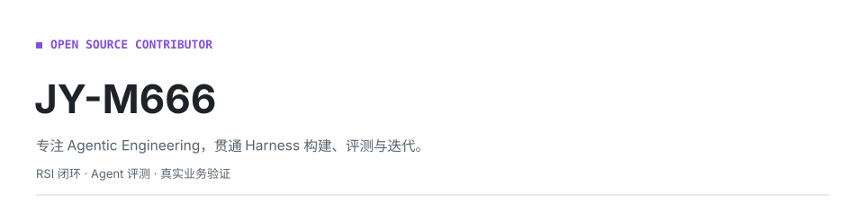
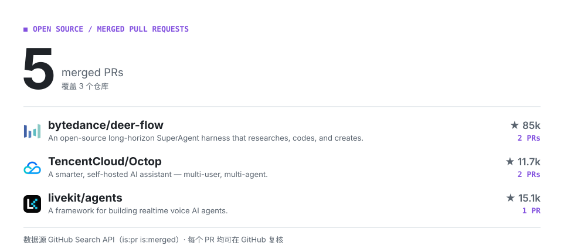

<picture>
  <source media="(prefers-color-scheme: dark)" srcset="./assets/hero-dark.svg">
  
</picture>

## 关于我

我专注于 Agentic Engineering，具备从 Harness 设计与实现到评测驱动迭代的完整实践能力：构建上下文、工具、反馈回路、状态与记忆机制；基于公开基准与真实业务任务搭建评测，量化能力提升并定位失效原因；构建 RSI（Recursive Self-Improvement，递归自我改进）闭环，让 Agent 根据执行轨迹和评测反馈持续优化 Prompt、工具与工作流，沉淀可复用技能，并验证改进效果。

<!-- CONTRIB:BEGIN -->
<picture>
  <source media="(prefers-color-scheme: dark)" srcset="./assets/contrib-dark.svg">
  
</picture>
<!-- CONTRIB:END -->

## 参与的开源项目

### [bytedance/deer-flow](https://github.com/bytedance/deer-flow)

面向研究、编码和创作任务的开源长周期 SuperAgent 框架。

**贡献方向：** 网页抓取内容解析、llama.cpp 本地模型配置文档。

- [修复网页抓取标题对制表符的识别（PR #6923）](https://github.com/bytedance/deer-flow/pull/6923)
- [补充 llama.cpp 本地模型配置文档（PR #5688）](https://github.com/bytedance/deer-flow/pull/5688)

### [TencentCloud/Octop](https://github.com/TencentCloud/Octop)

支持多用户和多 Agent 的自托管 AI 助手。

**贡献方向：** Chromium 兼容性、Windows 系统托盘交互与本地化。

- [为 Chromium 90 增加 Object.hasOwn 兼容处理（PR #826）](https://github.com/TencentCloud/Octop/pull/826)
- [改用原生系统托盘菜单并支持即时语言切换（PR #827）](https://github.com/TencentCloud/Octop/pull/827)

### [livekit/agents](https://github.com/livekit/agents)

实时语音 AI Agent 开发框架。

**贡献方向：** Fireworks 语音识别流的语言选项覆盖。

- [修复流级语言设置未生效的问题（PR #8390）](https://github.com/livekit/agents/pull/8390)
